## 📊 UIII Act4  Importación y descripción de datos con Pandas ML
## Cristopher Lopez Nc 1374
> **🎓 Asignatura:** Soluciona problemas de Machine Learning  
> **📚 Nivel:** Tercer semestre de preparatoria  
> **🤖 Especialidad:** Inteligencia Artificial  
> **📈 Dificultad:** Cero a principiante  
> **🐍 Lenguaje:** Python  
> **🛠️ Herramientas:** Visual Studio Code, Pandas, Matplotlib y CSV  

## tipos de semillas
 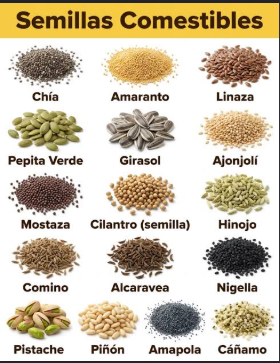
## tabla original 
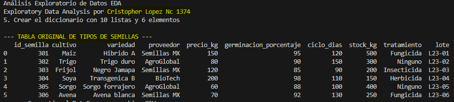
## 7. conertir el DataFrame en archivo CSV
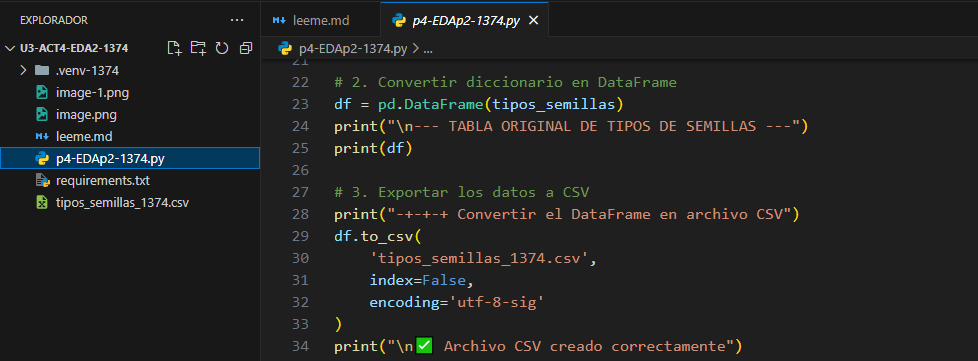
## datos del CSV 
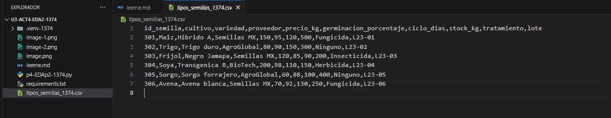
## 8. Leer los datos desde el archivo CSV
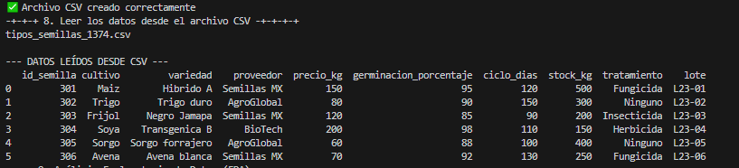
## 9. Análisis Exploratorio de Datos (EDA)
### primeros y ultimos registros 
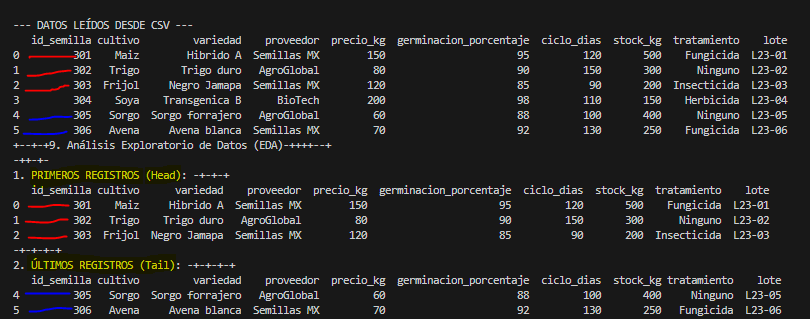

## 6. Dimensiones y estructura
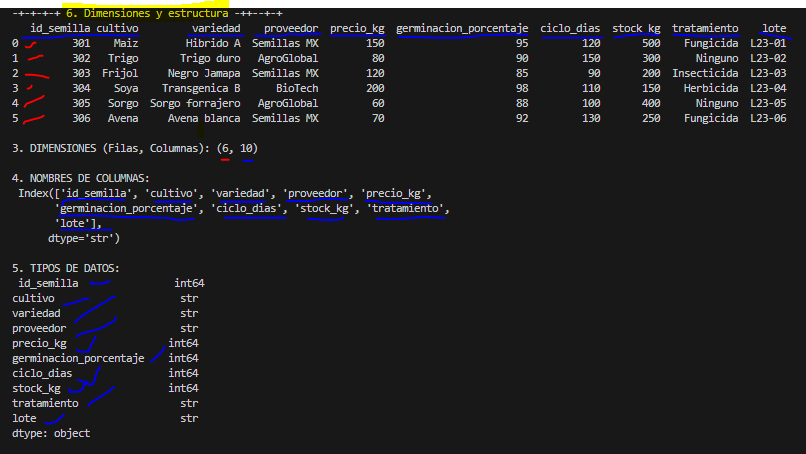

## 7. Estadísticas y limpieza
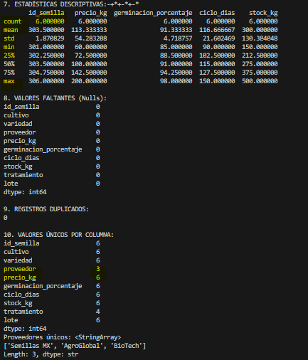

## 8 y 9 ordenamiento y filtrado y agrupacion 
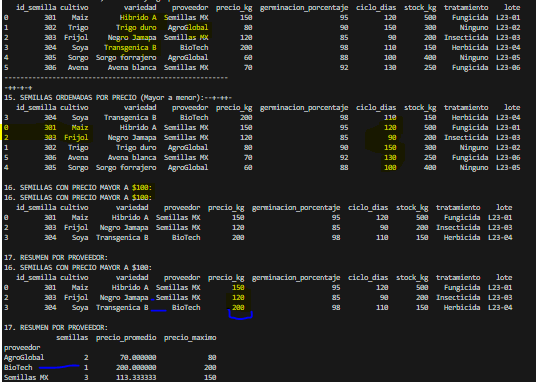

## 18. Gráfica de barras: tipos de semilla por provedor
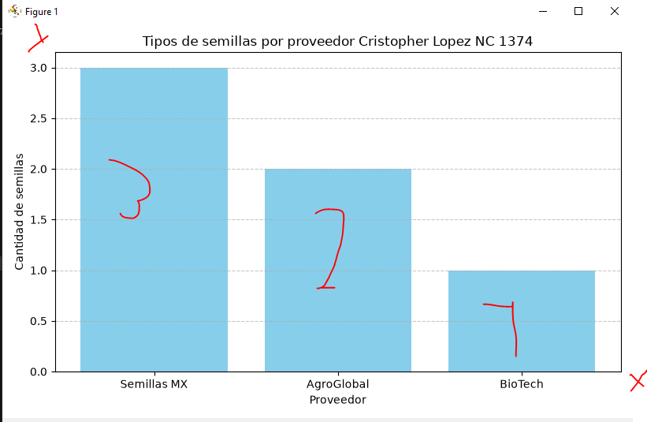
## 19. Gráfica de barras: precio por kg por cultivo
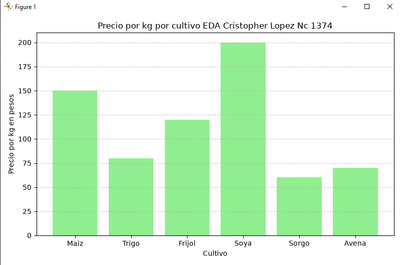
## 20. Histograma: Distribución de ciclos de cultivo
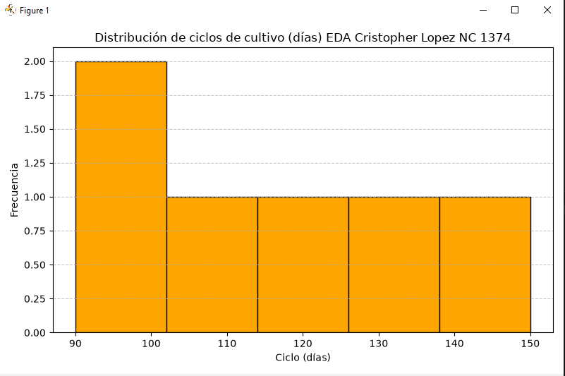
## 21. Gráfica de dispersión: Edad vs Salario
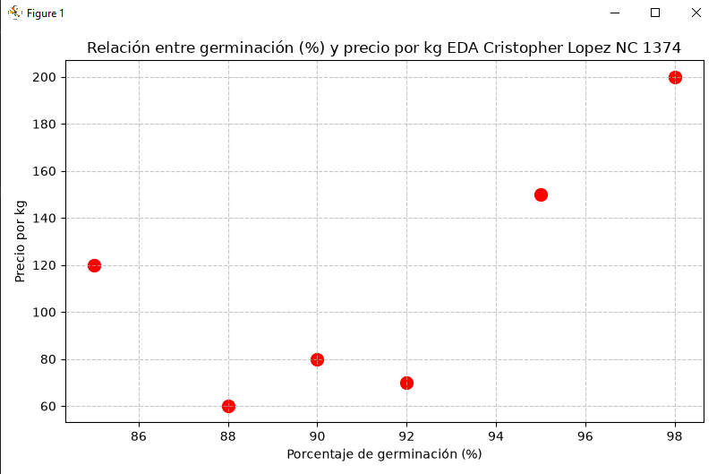

## 22. Diagrama de caja: Distribución de salarios
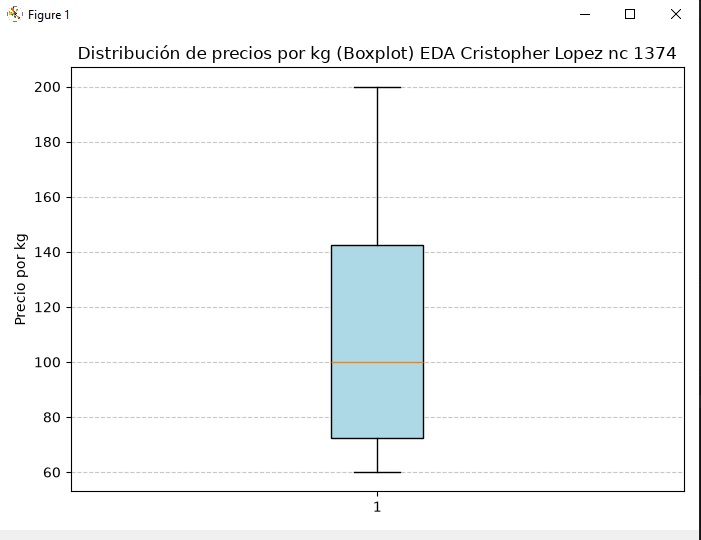

# 23. Matriz de correlación
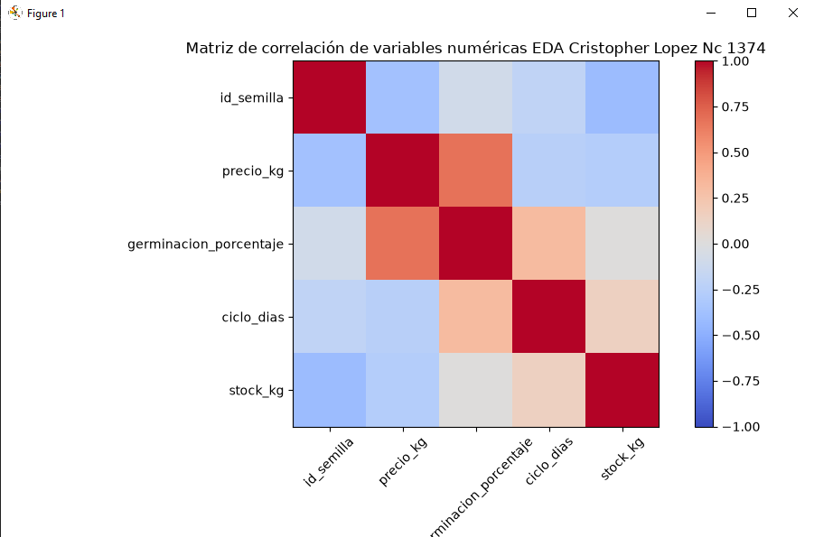